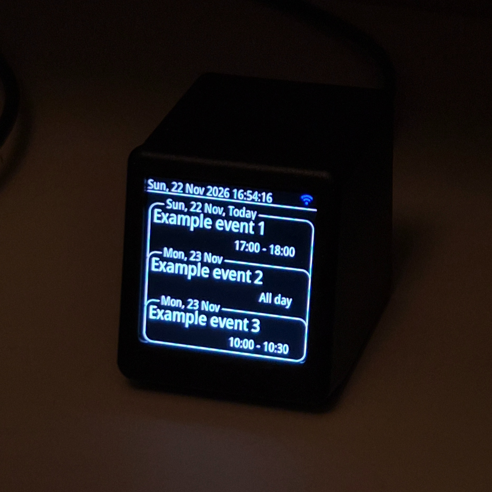

# ESP Calendar

A small desk calendar using the GeekMagic hardware that shows upcoming Google Calendar events. It's meant to help with keeping track of your schedule and plans by constantly displaying upcoming events.



## Features

- Upcoming Google Calendar events shown 24/7
- Read-only access to Google Calendar API
- Google sign-in through the OAuth device flow, no keyboard or browser needed on the device
- Refresh token saved to persistent memory (EEPROM), so sign-in is needed only once
- Time synchronised over NTP
- Web UI (`/settings`) to enable or disable individual calendars and to trigger a refresh
- Over-the-air firmware updates with ElegantOTA (`/update`)

## Hardware

Two GeekMagic hardware versions are supported, each with its own PlatformIO environment:

| Environment | Device | MCU | `board` |
|:---|:---|:---|:---|
| `esp32-wroom` | GeekMagic SmallTV Pro (classic ESP32) | ESP32 | `esp32dev` |
| `esp32-s3-devkitc-1` | GeekMagic S3 | ESP32-S3 | `adafruit_metro_esp32s3` |

> GeekMagic SmallTV Ultra (no button version) is not currently supported

> At least 8 MB of flash is required

### Display pins

The display is configured in `include/tft_setup.h` for TFT_eSPI.

| Signal | ESP32-WROOM GPIO | ESP32-S3 GPIO |
|:---|---:|---:|
| MOSI | 23 | 11 |
| SCLK | 18 | 12 |
| DC | 2 | 7 |
| RST | 4 | 6 |
| Backlight | 25 | 14 |
| CS | hardwired to GND | not used (-1) |
| Colour order | BGR | RGB |

The touch button uses `T9` (see `TOUCH_PIN` in `src/main.cpp`).

> **Warning:** Different versions and revisions of the SmallTV can use a different GPIO layout, display colour order or SPI settings. The values above worked on my units but may differ. Verify the pinout of your device and adjust `include/tft_setup.h` before flashing. Wrong pins usually result in a blank or garbled display, wrong colours, or a dead backlight.

## Setup

### Prerequisites
1. PlatformIO is installed (VSCode extension recommended)
2. USB-to-UART bridge drivers are installed
3. A Google Cloud project with an OAuth client ID of type **TVs and Limited Input devices**, with the Google Calendar API enabled

### 1. Create `config.h`

This file is excluded from Git. Create it in the `include/` folder (`include/config.h`):

```cpp
constexpr char WIFI_SSID[]     = "your-wifi-name";
constexpr char WIFI_PASSWORD[] = "your-wifi-password";

constexpr char CLIENT_ID[]     = "your-google-oauth-client-id";
constexpr char CLIENT_SECRET[] = "your-google-oauth-client-secret";
```

> **Note:** `config.h` holds secrets. Never commit or share it.

### 2. Build and flash

1. Open **PlatformIO**
2. Select the environment that matches your device (`esp32-wroom` or `esp32-s3-devkitc-1`)
3. Run **Upload**
4. Run **Upload File System Image**
5. Open **Monitor** (115200 baud)

### 3. Sign in to Google

On the first start the device requests a device code from Google. Follow the verification URL and code printed in the serial monitor, and approve access with your Google account. The refresh token is then stored on the device.

### 4. Open the settings page

Find the device's IP address in your router's device list or in the serial monitor, then open `http://<device-ip>/` in a browser on the same network. It redirects to `/settings`, where calendars can be enabled or disabled.

## Notes

- Events are refreshed every 60 s
- The NTP time offset is hard-coded to UTC+1 (`timeClient.setTimeOffset(3600)` in `src/main.cpp`). Change it for your time zone
- The device name on the network is `ESP32`
- The web UI and OTA page have no login. Use the device only on a trusted network
- AP/captive portal setup for Wi-Fi is not yet implemented. Wi-Fi credentials are set in `config.h` at build time
- Wi-Fi icon is just a placeholder
